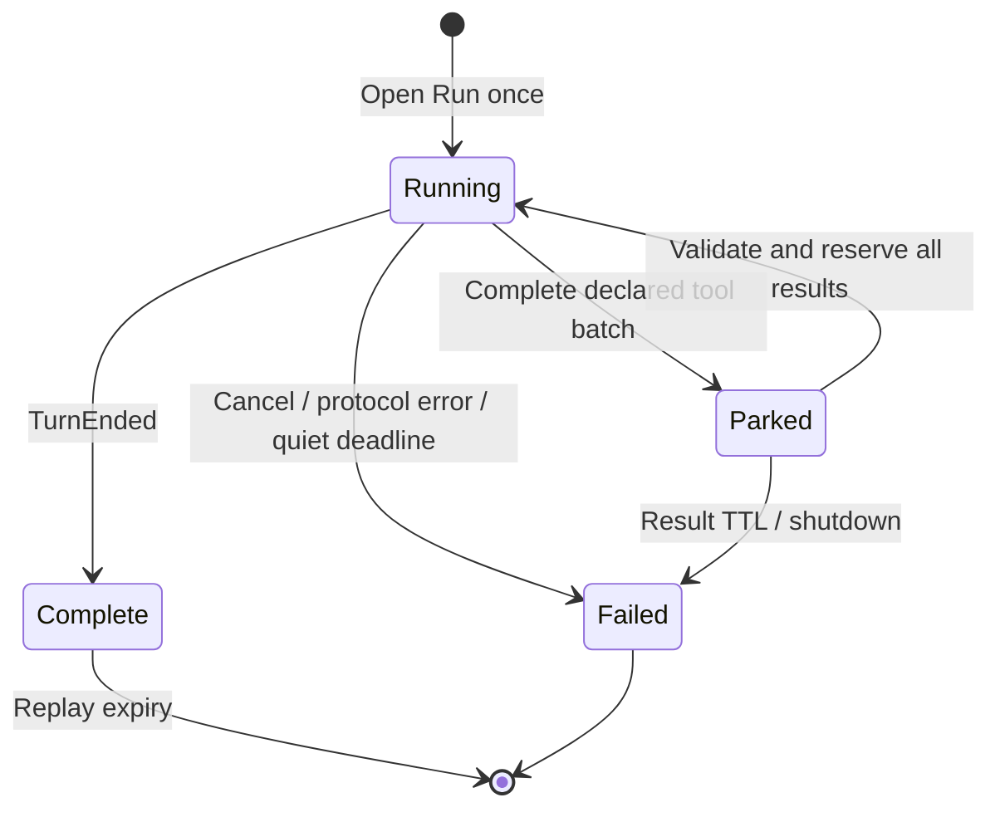

# Native Cursor sessions

The native path retains one upstream AgentService Run across caller tool
batches. It is inspired by Magpie Cursor 0.2.23, with an independent Go
implementation and pooled HTTP transports. See `NOTICE.md` for the pinned source.

## Selecting transport

CPA's schema-v1 executor callbacks accept a fixed byte request body and last for
one downstream request. They cannot write into a retained HTTP/2 request, expose
the resolved proxy/custom TLS policy, or provide a persistent callback lease.
Consequently, runtime-owned transport requires an explicit operator route:

```yaml
transport: native
native-proxy-url: direct # or http(s)://proxy:port, socks5(h)://proxy:port
```

`auto` (default) uses native sessions only when that route is explicit. An empty
route keeps CPA's existing host HTTP path. `host` always selects stateless
RunSSE/BidiAppend. Authentication, model catalog and management requests still
use the host callbacks, so configure both routes consistently. Host-specific
custom TLS transports are not copied; native uses system certificate trust.
No environment proxy or direct route is silently inferred by the native path.

The native connection pool separates accounts, endpoint and proxy identity,
reuses TLS connections, bounds entries and closes idle connections on eviction.
HTTP/2 `AgentService/Run` uses a streaming request body and reads responses before
request EOF. Only failure to negotiate H2 **before any HTTP request is submitted**
permits an HTTP/1 RunSSE/BidiAppend fallback. An uncertain write, rejected Run,
response-head timeout or partial response is never replayed. H2 capability is
retried after ten minutes. Proxy credentials and bearer values are not logged.

## Ownership and continuation



Handles contain an unguessable owner identity, turn and call index. The next
request must match the account, model/Max/Fast parameters, optional caller
scope, complete history, emitted tool calls and executable tool contract.
Description-only changes are accepted; changed schemas, strictness or policy
are rejected. Every result is checked before the first upstream write, then
reserved atomically. Concurrent or changed retries return 409. A fully delivered
response can be replayed for an identical result request without writing to
Cursor or charging another Run. This is process-local replay, not a promise of
exactly-once external side effects across crashes.

CPA normalizes the executor's `SourceFormat` to Chat even for Responses callers;
the plugin recovers that distinction from the original request envelope. For
Responses only, it accepts the exact reasoning-block separators CPA reconstructs
from the plugin's own output events. It does not trim arbitrary text, accept
changed tool arguments, or relax the earlier-history digest.

A delivered tool handoff detaches from the originating HTTP request. Active
inference remains attached to its caller context. Streaming callbacks emit an
empty-choices keepalive every second during native Open, then every five seconds
to observe CPA cancellation during quiet inference; the opening watcher is
stopped and joined before normal streaming, and all callbacks are drained before
scope shutdown. The stock nonstream
ABI has no push cancellation callback, so caller disconnection before a complete
nonstream response cannot be detected promptly. Prefer streaming for native
tool workflows. Plugin shutdown cancels both modes and waits for workers.

Limits: eight retained owners per account, 32 per process, 120-second tool-result
wait, 15-minute Run lifetime, 30-second incomplete-batch wait, 16 MiB retained
history/output budget and 64 MiB blobs. Native execs receive heartbeats while
waiting for caller results. The upstream watchdog only runs while waiting on
Cursor: 60 seconds without any frame or 240 seconds of heartbeat-only traffic.
Real thinking resets the quiet timer; parking pauses it. Transport open/write
and proxy handshakes are separately bounded at 15 seconds for connection and
response-head establishment; queued writes have a 30-second bound.

Expired owners, restart, changed history/compaction and uncertain submissions
return explicit 409 rather than silently sending results to another native exec.
A new user turn with complete history starts a fresh Run. Retention is for tool
continuations within a turn; it does not eliminate all future history imports.
Checkpoints and blobs help the live Run only; they are not restart handles.

## Accounting and context

Tool handoffs omit usage and return immediately. Native TurnEnded and Dashboard
counters describe the **whole Run**. They are written once to the revision-aware
journal, not divided among tool requests or presented as current-context tokens.
After a Run closes, a bounded asynchronous Dashboard lookup uses the configured
native transport. It does not wait on the response path or call into an expired
host scope. Later measurements can still revise an event; the journal preserves
revisions. Failed storage does not discard a valid inference.

This means client-side automatic compaction cannot rely on an exact native
per-step usage counter from this provider. The requested 500K model selection is
preserved, but it is not proof of filling that window or of automatic compaction
working across a parked tool handoff. A context mismatch is surfaced explicitly.
CPA versions that turn missing usage into a zero accounting row still need the
separate upstream presence fix; see `host-compatibility.md`.

Native Chat replies expose `cursor_usage` (state, Run ID, replay/continuation and
transport). CPA Responses can discard custom fields. Use the separate journal
and returned call handles for continuity evidence. The plugin emits raw JSON
chunks; CPA alone supplies SSE `data:` framing and `[DONE]`.
