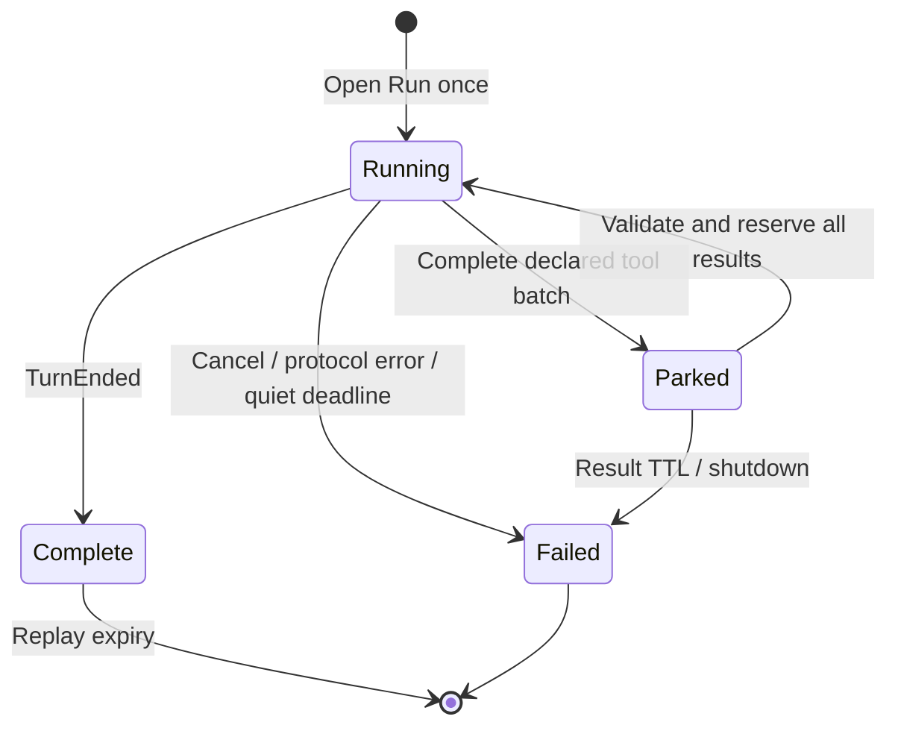

# Native Cursor sessions

The native path retains one upstream AgentService Run across caller tool
batches. It is inspired by Magpie Cursor 0.2.23, with an independent Go
implementation and pooled HTTP transports. See `NOTICE.md` for the pinned source.

## Selecting transport

CPA's schema-v1 executor callbacks accept a fixed byte request body and last for
one downstream request. They cannot write into a retained HTTP/2 request, expose
the resolved proxy/custom TLS policy, or provide a persistent callback lease.
Consequently, runtime-owned transport requires an explicit operator route:

```yaml
transport: native
native-proxy-url: direct # or http(s)://proxy:port, socks5(h)://proxy:port
```

`auto` (default) uses native sessions only when that route is explicit. An empty
route keeps CPA's existing host HTTP path. `host` always selects stateless
RunSSE/BidiAppend. Authentication, model catalog and management requests still
use the host callbacks, so configure both routes consistently. Host-specific
custom TLS transports are not copied; native uses system certificate trust.
No environment proxy or direct route is silently inferred by the native path.

The native connection pool separates accounts, endpoint and proxy identity,
reuses TLS connections, bounds entries and closes idle connections on eviction.
HTTP/2 `AgentService/Run` uses a streaming request body and reads responses before
request EOF. Only failure to negotiate H2 **before any HTTP request is submitted**
permits an HTTP/1 RunSSE/BidiAppend fallback. An uncertain write, rejected Run,
response-head timeout or partial response is never replayed. H2 capability is
retried after ten minutes. Proxy credentials and bearer values are not logged.

## Ownership and continuation



Handles contain an unguessable owner identity, turn and call index. The next
request must match the account, model/Max/Fast parameters, optional caller
scope, complete history, emitted tool calls and executable tool contract.
Description-only changes are accepted; changed schemas, strictness or policy
are rejected. Every result is checked before the first upstream write, then
reserved atomically. Concurrent or changed retries return 409. A fully delivered
response can be replayed for an identical result request without writing to
Cursor or charging another Run. This is process-local replay, not a promise of
exactly-once external side effects across crashes.

CPA normalizes the executor's `SourceFormat` to Chat even for Responses callers;
the plugin recovers that distinction from the original request envelope. For
Responses only, it accepts the exact reasoning-block separators CPA reconstructs
from the plugin's own output events. It does not trim arbitrary text, accept
changed tool arguments, or relax the earlier-history digest.

A delivered tool handoff detaches from the originating HTTP request. Active
inference remains attached to its caller context. Streaming callbacks emit an
empty-choices keepalive every second during native Open, then every five seconds
to observe CPA cancellation during quiet inference; the opening watcher is
stopped and joined before normal streaming, and all callbacks are drained before
scope shutdown. The stock nonstream
ABI has no push cancellation callback, so caller disconnection before a complete
nonstream response cannot be detected promptly. Prefer streaming for native
tool workflows. Plugin shutdown cancels both modes and waits for workers.

Limits: eight retained owners per account, 32 per process, 120-second tool-result
wait, 15-minute Run lifetime, 30-second incomplete-batch wait, 16 MiB retained
history/output budget and 64 MiB blobs. Native execs receive heartbeats while
waiting for caller results. The upstream watchdog only runs while waiting on
Cursor: 60 seconds without any frame or 240 seconds of heartbeat-only traffic.
Real thinking resets the quiet timer; parking pauses it. Transport open/write
and proxy handshakes are separately bounded at 15 seconds for connection and
response-head establishment; queued writes have a 30-second bound.

Locally identified network failures retain HTTP 502/504 and carry the existing
CPA ABI's two-second retry hint. On stock 8.0.43 this replaces its otherwise
minute-long cooldown for that transport fault. Actual upstream HTTP/Connect
errors (including authentication and quota), protocol errors, certificate
verification failures and caller cancellation do not acquire this hint. It
does not replay a write or change global cooldown configuration; older hosts
may ignore the optional ABI field.

Expired owners, restart, changed history/compaction and uncertain submissions
return explicit 409 rather than silently sending results to another native exec.
A new user turn with complete history starts a fresh Run. Retention is for tool
continuations within a turn; it does not eliminate all future history imports.
Checkpoints and blobs help the live Run only; they are not restart handles.

A new explicit user message can retire a delivered parked predecessor only
when account, conversation, caller scope and the complete old history prefix
match. Its completion hook releases ownership before the new Run opens. Initial
request retries, unrelated histories and currently running/submitting owners do
not trigger replacement. Late results for the retired handles fail instead of
being sent to another execution.

## Accounting and context

Tool handoffs omit usage and return immediately. Native TurnEnded and Dashboard
counters describe the **whole Run**. They are written once to the revision-aware
journal, not divided among tool requests or presented as current-context tokens.
After a Run closes, a bounded asynchronous Dashboard lookup uses the configured
native transport. It does not wait on the response path or call into an expired
host scope. Later measurements can still revise an event; the journal preserves
revisions. Failed storage does not discard a valid inference.

This means client-side automatic compaction cannot rely on an exact native
per-step usage counter from this provider. The requested 500K model selection is
preserved, but it is not proof of filling that window or of automatic compaction
working across a parked tool handoff. A context mismatch is surfaced explicitly.
CPA versions that turn missing usage into a zero accounting row still need the
separate upstream presence fix; see `host-compatibility.md`.

Native Chat replies expose `cursor_usage` (state, Run ID, replay/continuation and
transport). CPA Responses can discard custom fields. Use the separate journal
and returned call handles for continuity evidence. The plugin emits raw JSON
chunks; CPA alone supplies SSE `data:` framing and `[DONE]`.

## Revisioned desktop accounting (0.2.1)

Every native terminal reply also carries a small `usage_accounting` reference:
`provider`, `scope=run`, opaque `record_id`, `state`, `resumed` and `replay`.
A supporting CPA host preserves that reference through Responses translation
and its usage queue without inventing request token measurements. The desktop
collector uses it to join HTTP requests to an independent Run ledger. One Run
contributes its latest observed counters once, regardless of its number of tool
requests, retries, query refreshes or pages. Later observations replace the
previous value, including downward revisions.

The authenticated plugin `accounting` management route accepts
`after_sequence` (default 0) and `limit` (1–100). It returns schema version 1,
the journal high-water `sequence`, `next_sequence`, `has_more` and `records`.
Consumers probe the stable `instance_id` with `after_sequence=0&limit=1`,
then persist a cursor per host/port/instance transactionally with
ID/sequence-based upserts. A fresh journal has a new identity even when its
sequence is greater than the previous journal's cursor.
The feed reads the append archive as well as current memory; restarting a Run
publishes a new interrupted-state revision for existing consumers. The host's
current `/v8/management` entry maps to the existing plugin route; older hosts
provide it under `/v0/management` only.

Public records contain Run start/end time, requested and upstream model,
measurement source, status, provisional/stable flags, nullable usage and local
timing. They contain no credentials, account/CID/event identities, prompts,
tool arguments or journal paths. A Dashboard field absent from its JSON stays
unknown. `reported_input_tokens` and `reported_total_tokens` are sums of the
explicitly reported components; they are labelled as reported amounts when the
complete input composition is unavailable. They never become standard context
usage. Sampling stability does not establish immutable billing finality.

Active Runs receive a bounded background Dashboard snapshot every ten seconds.
Its provisional counters remain separate from terminal reconciliation. Closing
the Run cancels and drains that observer before recording final data. Local
active-inference time excludes parked client tool execution and response replay;
output divided by that duration is a Run effective rate, not decoder TPS.

## Optional client context estimates

`client-context-estimate: true` explicitly requests a supporting host's local
tokenizer estimate for Responses clients that otherwise cannot auto-compact
without standard usage. It is disabled by default. The host counts the current
complete prompt and the current reply, preserves the real accounting snapshot
before adding client-facing estimates, and marks `response.context_usage` as
`estimated` with its actual tokenizer encoding and `scope=request_context`.
Known upstream request usage is never replaced.

The local tokenizer is an approximation for Grok and cannot observe Cursor's
hidden prompt. Codex 0.163 uses these estimated standard counters for its own
context display and token budgets as well as auto-compaction; it ignores the
extra provenance field. This opt-in compatibility mode must therefore be
disclosed to callers. Desktop billing, cache measurements and Run rates continue
to use the independent measured ledger. Preserve the configured context window
and compaction threshold; do not treat successful compaction as proof that the
estimate equals the provider's exact occupancy.
