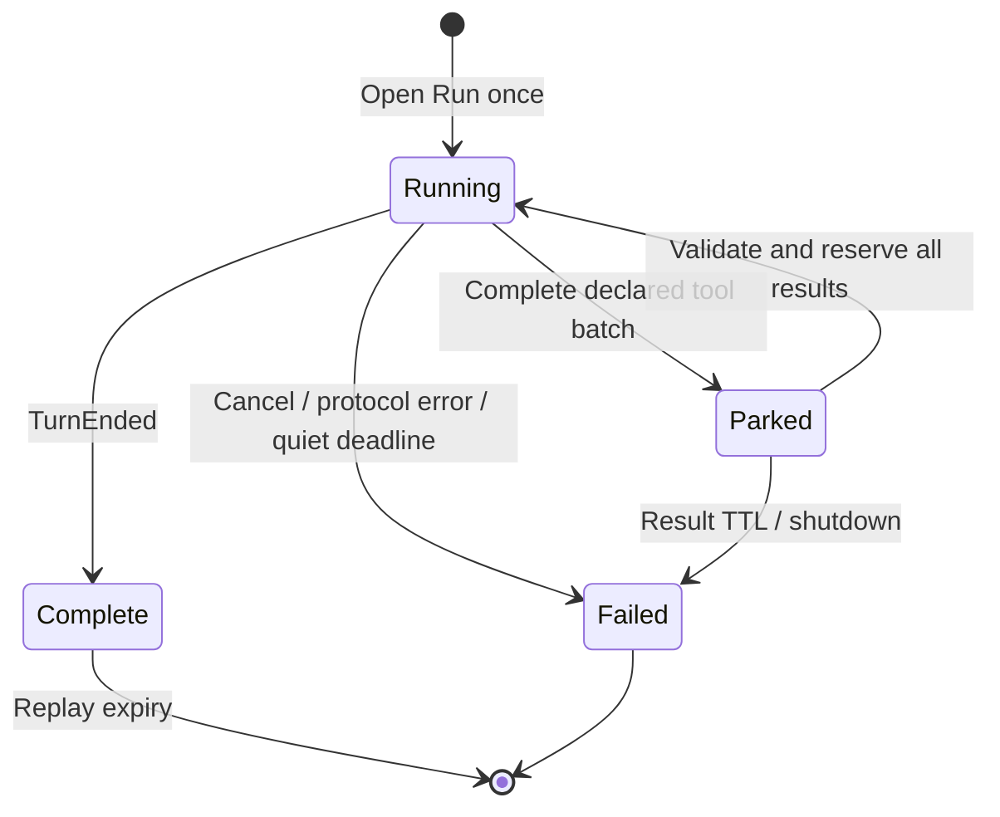

# Native Cursor sessions

The native path retains one upstream AgentService Run across caller tool
batches. It is inspired by Magpie Cursor 0.2.23, with an independent Go
implementation and pooled HTTP transports. See `NOTICE.md` for the pinned source.

## Selecting transport

CPA's schema-v1 executor callbacks accept a fixed byte request body and last for
one downstream request. They cannot write into a retained HTTP/2 request, expose
the resolved proxy/custom TLS policy, or provide a persistent callback lease.
Consequently, runtime-owned transport requires an explicit operator route:

```yaml
transport: native
native-proxy-url: direct # or http(s)://proxy:port, socks5(h)://proxy:port
native-tool-result-timeout-seconds: 120
native-run-lifetime-seconds: 900
```

`auto` (default) uses native sessions only when that route is explicit. An empty
route keeps CPA's existing host HTTP path. `host` always selects stateless
RunSSE/BidiAppend. Authentication, model catalog and management requests still
use the host callbacks, so configure both routes consistently. Host-specific
custom TLS transports are not copied; native uses system certificate trust.
No environment proxy or direct route is silently inferred by the native path.

The native connection pool separates accounts, endpoint and proxy identity,
reuses TLS connections, bounds entries and closes idle connections on eviction.
HTTP/2 `AgentService/Run` uses a streaming request body and reads responses before
request EOF. Only failure to negotiate H2 **before any HTTP request is submitted**
permits an HTTP/1 RunSSE/BidiAppend fallback. An uncertain write, rejected Run,
response-head timeout or partial response is never replayed. H2 capability is
retried after ten minutes. Proxy credentials and bearer values are not logged.

## Ownership and continuation



Handles contain an unguessable owner identity, turn and call index. The next
request must match the account, model/Max/Fast parameters, optional caller
scope, complete history, emitted tool calls and executable tool contract.
Description-only changes are accepted; the complete declared tool set, schemas
and strictness remain fixed. `tool_choice` and `parallel_tool_calls` govern the
next response and may change when submitting a new complete result batch, within
the tool catalog introduced at native bootstrap. For example, `required` can
become `auto` or `none` so the same Run can return final text. A forced choice can
likewise become `auto` when that does not introduce additional native tools.

The initial forced choice exposes only its selected tool. If the declaration
also contained another tool, switching to `auto` would expand the native catalog
and returns 409 with an explicit new-user-turn boundary. `none` with the unchanged
declarations can still finish that Run. A policy cannot hide a schema change or
silently create another native Run. See [tool policy details](tool-payload.md).

Every result is checked before the first upstream write, then reserved atomically
with the next response's policy. Concurrent or changed retries return 409. A fully delivered
response can be replayed for an identical result request and policy without writing to
Cursor or charging another Run. This is process-local replay, not a promise of
exactly-once external side effects across crashes.

CPA normalizes the executor's `SourceFormat` to Chat even for Responses callers;
the plugin recovers that distinction from the original request envelope. For
Responses only, it accepts the exact reasoning-block separators CPA reconstructs
from the plugin's own output events. It does not trim arbitrary text, accept
changed tool arguments, or relax the earlier-history digest.

A delivered tool handoff detaches from the originating HTTP request. Active
inference remains attached to its caller context. Streaming callbacks emit an
empty-choices keepalive every second during native Open, then every five seconds
to observe CPA cancellation during quiet inference; the opening watcher is
stopped and joined before normal streaming, and all callbacks are drained before
scope shutdown. The stock nonstream
ABI has no push cancellation callback, so caller disconnection before a complete
nonstream response cannot be detected promptly. Prefer streaming for native
tool workflows. Plugin shutdown cancels both modes and waits for workers.

Limits: eight retained owners per account, 32 per process, a default 120-second
tool-result wait and 15-minute Run lifetime, 30-second incomplete-batch wait, 16 MiB retained
history/output budget and 64 MiB blobs. Native execs receive heartbeats while
waiting for caller results. The upstream watchdog only runs while waiting on
Cursor: 60 seconds without any frame or 240 seconds of heartbeat-only traffic.
Real thinking resets the quiet timer; parking pauses it. Transport open/write
and proxy handshakes are separately bounded at 15 seconds for connection and
response-head establishment; queued writes have a 30-second bound.

`native-tool-result-timeout-seconds` accepts 15–900 seconds;
`native-run-lifetime-seconds` accepts 60–3600 seconds, with the tool wait strictly
shorter than the Run lifetime. Each actual handoff deadline is the earlier of
`now + tool wait` and `Run expiry - processing reserve`; the reserve is the
smaller of 60 seconds or one tenth of the Run lifetime. A late handoff is rejected
before publishing tools when no processing reserve remains. These are bounded
local limits, not renewable leases or a promise of upstream resumability.

Chat's `cursor_usage.deadlines` contains the Run expiry and actual pending-tool
deadline when available. CPA Responses can drop extension fields or headers, so
the plugin does not claim Codex sees each deadline. The existing authenticated
accounting route reports effective transport and configured native limits for
operators without exposing proxy URLs or per-Run identifiers.

Locally identified network failures retain HTTP 502/504 and carry the existing
CPA ABI's two-second retry hint. On stock 8.0.43 this replaces its otherwise
minute-long cooldown for that transport fault. Actual upstream HTTP/Connect
errors (including authentication and quota), protocol errors, certificate
verification failures and caller cancellation do not acquire this hint. It
does not replay a write or change global cooldown configuration; older hosts
may ignore the optional ABI field.

Permanently expired, ended or missing owners, including handles from before a
restart, return **410 Gone** rather than a retryable busy conflict. The error
includes a stable `cursor_native_*` code, a bounded reason and
`retry_same_request=false`. Busy/in-flight or correctable contract conflicts
remain 409; a first transport failure retains its original 502/504 status.
An uncertain write is never silently replayed into a different native exec.
Generic host/client retry behavior must be checked on the actual versions; a
machine code alone is not proof that the client stops retrying.

A new user turn with complete history starts a fresh Run. Inspect completed
tool side effects before continuing, because a missing execution owner does not
prove its earlier tool actions failed. Retention is for tool
continuations within a turn; it does not eliminate all future history imports.
Checkpoints and blobs help the live Run only; they are not restart handles.

The process retains at most 128 sanitized failure summaries for ten minutes,
scoped by account/caller ownership hashes. They preserve the original failure
classification for a late handle lookup; they contain no history, bearer, URL
or response body and cannot restore execution. Unknown failures remain explicitly
unclassified rather than being assigned an invented upstream cause.

A new explicit user message can retire a delivered parked predecessor only
when account, conversation, caller scope and the complete old history prefix
match. Its completion hook releases ownership before the new Run opens. Initial
request retries, unrelated histories and currently running/submitting owners do
not trigger replacement. Late results for the retired handles fail instead of
being sent to another execution.

## Accounting and context

Tool handoffs omit usage and return immediately. Native TurnEnded and Dashboard
counters describe the **whole Run**. They are written once to the revision-aware
journal, not divided among tool requests or presented as current-context tokens.
After a Run closes, a bounded asynchronous Dashboard lookup uses the configured
native transport. It does not wait on the response path or call into an expired
host scope. Later measurements can still revise an event; the journal preserves
revisions. Failed storage does not discard a valid inference.

This means client-side automatic compaction cannot rely on an exact native
per-step usage counter from this provider. The requested 500K model selection is
preserved, but it is not proof of filling that window or of automatic compaction
working across a parked tool handoff. A context mismatch is surfaced explicitly.
CPA versions that turn missing usage into a zero accounting row still need the
separate upstream presence fix; see `host-compatibility.md`.

Native Chat replies expose `cursor_usage` (state, Run ID, replay/continuation and
transport). CPA Responses can discard custom fields. Use the separate journal
and returned call handles for continuity evidence. The plugin emits raw JSON
chunks; CPA alone supplies SSE `data:` framing and `[DONE]`.
